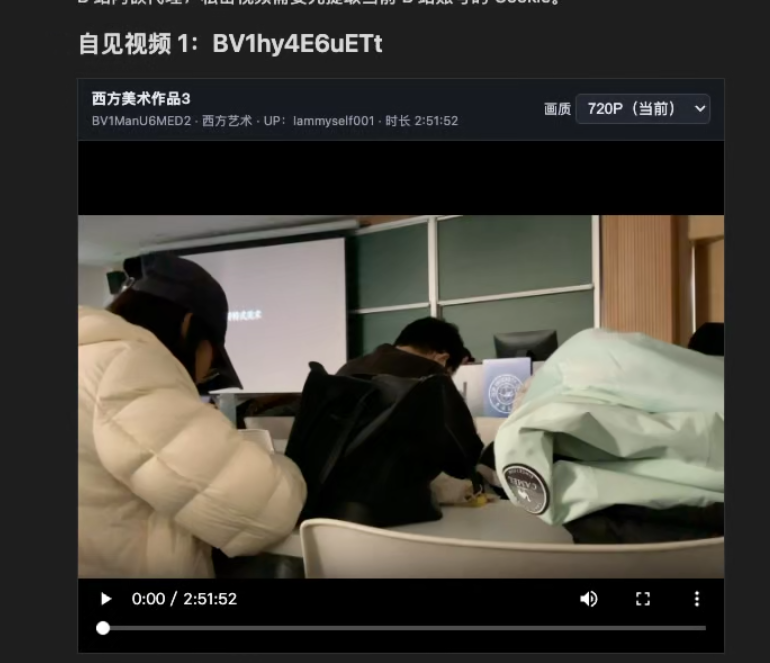
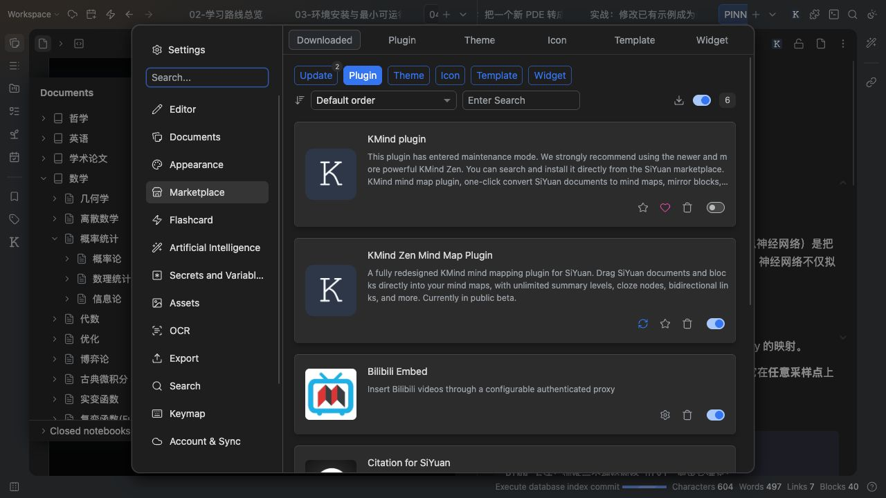
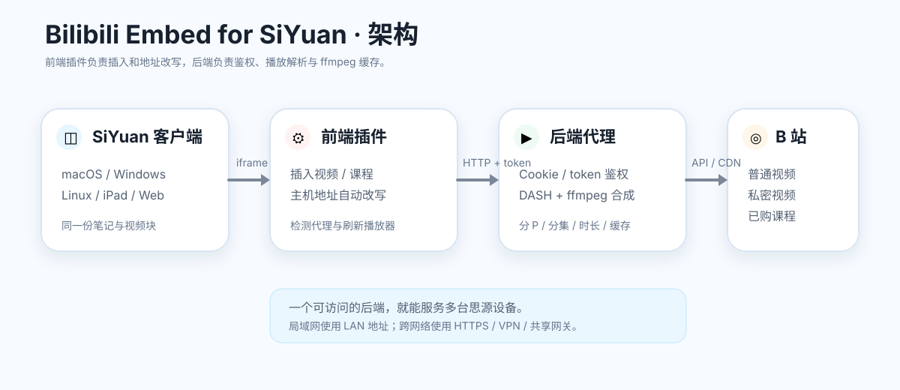

<p align="center">
  
</p>

<h1 align="center">Bilibili Embed for SiYuan</h1>

<p align="center">
  在思源笔记中插入普通视频、私密视频和已购买 B 站课程。
</p>

<p align="center">
  <a href="https://github.com/IammyselfYBX/siyuan-plugin-bilibli-embed-backend">后端仓库</a>
  ·
  <a href="https://github.com/IammyselfYBX/siyuan-plugin-bilibli-embed/issues">问题反馈</a>
</p>

---

## 功能

- 从 B 站链接、`BV` 号或课程 `ss` 号插入视频块；
- 支持公开视频、仅自见视频和已购买课程；
- 自动显示真实总时长、分 P / 分集标题和画质；
- 局域网访问时自动把 `127.0.0.1` 改写为当前思源主机；
- 自动附加代理 token，不把 token 写进笔记；
- 提供代理状态检测和播放器刷新；
- 插件本身不保存 B 站 Cookie。

## 界面预览





## 架构



前端插件负责：

- 插入视频块；
- 生成标准 iframe 地址；
- 根据当前思源主机改写地址；
- 附加代理 token；
- 显示代理状态。

鉴权、视频解析和缓存由独立的[后端][backend]负责：

**[前往后端仓库](https://github.com/IammyselfYBX/siyuan-plugin-bilibli-embed-backend)**

## 使用前先启动[后端][backend]

插件本身不负责 B 站鉴权、视频流解析或音视频转封装。

**使用前需要提前启动一个可访问的[后端][backend]。** 如果[后端][backend]没有运行：

- 插件仍然可以插入视频块；
- 但播放器会显示连接失败或“准备失败”。

[后端][backend]安装、扫码登录、启动和缓存说明请查看：

**[后端仓库 README](https://github.com/IammyselfYBX/siyuan-plugin-bilibli-embed-backend)**

启动[后端][backend]后，在插件设置中点击：

```text
检测代理状态
```

正常情况下会显示：

```text
代理已连接 · 已读取 N 个 Cookie · ffmpeg 正常
```

## 安装

把本仓库内容放到思源工作区：

```text
data/plugins/siyuan-plugin-bilibili-embed/
```

重启思源，然后进入：

```text
设置 → 集市 → 已安装插件
```

启用插件。

插件启用后，在思源的插件管理入口中会显示设置齿轮，点击即可打开插件设置页。

## 插入方式

### 打开命令面板

| 平台 | 默认快捷键 |
|---|---|
| macOS | `⌥⇧P` |
| Windows | `Alt+Shift+P` |
| Linux | `Alt+Shift+P` |
| 网页版思源 | `Alt+Shift+P` |

如果快捷键被占用，可以点击顶部工具栏的命令面板按钮，或者在思源设置中查看“命令面板”快捷键。

### 插入视频

1. 打开命令面板；
2. 搜索 `插入 B 站视频`；
3. 选择 `Bilibili Embed: 插入 B 站视频`；
4. 填写 B 站链接、`BV` 号或课程 `ss` 号；
5. 设置分 P / 分集、播放器高度和画质；
6. 点击“插入”。

成功后会提示：

```text
B 站视频已插入
```

视频会插入到当前块之后；如果当前没有可用光标位置，则追加到文档末尾。

## 支持的视频类型

| 类型 | 示例 | 说明 |
|---|---|---|
| 公开视频 | `BV1uM4n6kE2L` | [后端][backend]不需要 Cookie 也能解析公开内容 |
| 仅自见视频 | `BV1hy4E6uETt` | [后端][backend] Cookie 必须是视频所有者账号 |
| 已购买课程 | `ss1380` | [后端][backend] Cookie 必须是购买课程的账号 |
| 多 P 视频 | `?p=2` | 播放器右上角可切换分 P |
| 多集课程 | 第 1 集、第 2 集…… | 播放器右上角可切换分集 |

### 付费课程

支持已购买的 B 站课程，例如：

```text
https://www.bilibili.com/cheese/play/ss1380
```

也可以直接填写：

```text
ss1380
```

课程分集标题、时长和画质由 B 站课程接口返回。课程视频必须使用购买该课程的 B 站账号 Cookie；如果[后端][backend]账号没有购买，会提示不可观看或只能试看。

## 插件设置

插件设置中可以配置：

- 固定代理地址；
- 同主机代理端口；
- 代理访问 token；
- 默认播放器高度；
- 是否启用 B 站视频地址改写。

插件设置还提供：

- `检测代理状态`
- `刷新视频`

代理访问 token 输入框右侧有显示/隐藏按钮。

## 跨平台缓存

播放缓存由[后端][backend]管理，不写入思源资源目录。

- macOS：`~/Library/Caches/bilibili-embed`
- Windows：`%LOCALAPPDATA%/bilibili-embed/cache`
- Linux：`~/.cache/bilibili-embed`
- 如果首选目录不可写，会自动回退到系统临时目录

缓存默认保留 24 小时。详细说明见：

**[后端仓库](https://github.com/IammyselfYBX/siyuan-plugin-bilibli-embed-backend)**

## 代理地址与多设备

插件设置中的“固定代理地址”留空时，会使用当前思源页面的主机名：

- Mac 本机打开：使用 `127.0.0.1`；
- 局域网设备打开：使用当前局域网 IP；
- 通过 HTTPS 打开思源时，需要给[后端][backend]配置 HTTPS，避免混合内容拦截。

多个设备共用一个[后端][backend]时，建议填写固定的可达地址，例如：

```text
http://192.168.1.10:8771
```

或通过 Tailscale / 反向代理使用 HTTPS 地址。

[后端][backend]启动和局域网配置请参考：

**[后端仓库](https://github.com/IammyselfYBX/siyuan-plugin-bilibli-embed-backend)**

## 安全说明

不要提交或同步以下内容：

- `bilibili-cookies.txt`
- `bilibili-embed.env`
- [后端][backend] token
- Cookie 导出文件
- 专用浏览器 profile

这些内容分别由前端插件和[后端仓库][backend]的 `.gitignore` 处理。

## 相关仓库

- 前端插件：<https://github.com/IammyselfYBX/siyuan-plugin-bilibli-embed>
- [后端服务](https://github.com/IammyselfYBX/siyuan-plugin-bilibli-embed-backend)

[backend]: https://github.com/IammyselfYBX/siyuan-plugin-bilibli-embed-backend
